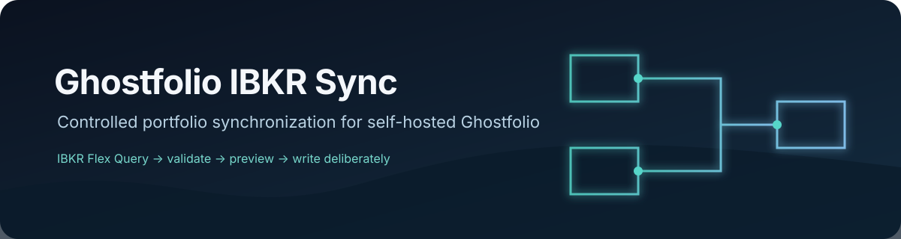
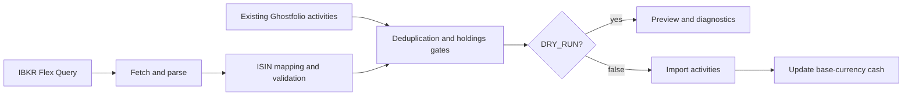

<p align="center">
  
</p>

<p align="center">
  <a href="https://github.com/flowcool/ghostfolio-ibkr-sync/releases"></a>
  <a href="https://github.com/flowcool/ghostfolio-ibkr-sync/actions/workflows/docker-publish.yml"></a>
  <a href="https://github.com/flowcool/ghostfolio-ibkr-sync/security"></a>
  <a href="LICENSE"></a>
</p>

<p align="center"><strong>Your Interactive Brokers portfolio, kept current in self-hosted Ghostfolio.</strong><br>Preview every run. Import additively. Keep financial writes deliberate.</p>

<p align="center"><a href="#quick-start">Quick start</a> · <a href="#what-it-does">What it does</a> · <a href="#safety-first">Safety</a> · <a href="docs/configuration.md">Configuration</a> · <a href="docs/troubleshooting.md">Troubleshooting</a> · <a href="https://github.com/flowcool/ghostfolio-ibkr-sync/releases">Releases</a></p>

## What it does

`ghostfolio-ibkr-sync` reads Interactive Brokers Flex Query reports and synchronizes supported trades, dividends, withholding tax, and base-currency cash into a self-hosted [Ghostfolio](https://ghostfol.io) instance. It runs as a Docker image, supports multiple IBKR sub-accounts, and can run once or on a schedule.

It is useful when manual activity entry has become repetitive or difficult to audit. The connector keeps the source-account identity, checks existing Ghostfolio activities before import, and makes the first run a full simulation by default.

## Key features

| User value | Supported behavior |
| --- | --- |
| **Portfolio synchronization** | Trades, dividend payments, withholding tax, and each account’s ending base-currency cash balance. Multiple IBKR accounts can run sequentially. |
| **Data integrity** | ISIN-to-Yahoo ticker mapping, duplicate detection by source identity and proximity rules, source-account isolation, currency checks, and holdings gates for sells. |
| **Controlled operations** | `DRY_RUN` simulation, explicit `DRY_RUN=false` for writes, fail-closed validation, bounded retries, structured diagnostics, and optional redacted Apprise failure summaries. |
| **Self-hosting** | Docker-only runtime, multi-architecture image (`linux/amd64` and `linux/arm64`), Compose/Portainer examples, and cron scheduling through `CRON`. |
| **Optional review** | Qualified one-to-one activity correction proposals through `ACTIVITY_REVIEW_FILE`; approval is explicit and corrections are never automatic. |

### Deliberate boundaries

Options and FX conversion trades are skipped. Flex Query data covers at most 365 days, so older positions must already exist in Ghostfolio. The connector detects corporate actions and holds unsafe BUY/SELL. Corporate-action treatment remains manual. Imports are additive: the connector does not delete activities, and ordinary runs do not rewrite historical records. See [limitations](#limitations) and the [activity review guide](docs/activity-review.md).

## How it works



The pipeline reads the existing Ghostfolio activity set before selecting imports. A simulation still authenticates, fetches reports, and evaluates the complete decision. It sends no activity, cash, platform, or correction write.

## Quick start

The fastest safe path is a Docker Compose preview. Prepare these prerequisites:

- Docker Compose, with the repository [`compose.yaml`](compose.yaml).
- Ghostfolio **2.248.0 or newer**, reachable from the Docker network.
- An IBKR account with Flex Web Service enabled.
- One Flex Query per IBKR sub-account, with a 365-day window and the fields listed in the [IBKR setup guide](docs/ibkr-setup.md).
- A private Ghostfolio access token, a valid IANA `TZ`, a reviewed `mapping.yaml`, and a private persistent state directory.

1. Copy the examples and edit the private environment file:

```bash
cp .env.example .env
cp mapping.yaml.example mapping.yaml
chmod 600 .env mapping.yaml
sudo chown 10001:10001 mapping.yaml
mkdir -p state/individual state/joint
chmod 700 state/individual state/joint
sudo chown 10001:10001 state/individual state/joint
```

2. Set the IBKR account and query IDs, Ghostfolio account names, and tokens in `.env`. Remove the unused joint service from `compose.yaml` if you have one account.
3. Validate the resolved Compose model without printing secrets:

```bash
docker compose config --quiet
```

4. Run one account in simulation and inspect the logs:

```bash
docker compose run --rm -e CRON= ibkr-sync-individual
```

5. Confirm that the simulation initialized corporate-action state and has no unresolved hold. Review its bounded event inventory; available report windows cannot prove lifetime coverage. Back up Ghostfolio. Set `DRY_RUN=false` only after the preview is understood, then run the same command once.
6. For recurring imports, set `CRON_INDIVIDUAL` and `CRON_JOINT` in `.env`, then start the services with `docker compose up -d`. The [configuration reference](docs/configuration.md) covers permissions, scheduling, Portainer deployment, and multi-account details.

The committed [`compose.yaml`](compose.yaml) and [`.env.example`](.env.example) are the canonical onboarding files. They use separate services for sub-accounts and keep credentials outside Git. The image starts with a simulation when `DRY_RUN` is absent or blank. Only `0`, `false`, `no`, or `off` request financial writes. Invalid values fail before HTTP calls. A missing or invalid `TZ` forces simulation. Read [upgrading to 3.0](docs/upgrading-to-3.0.md) before upgrading older installations.

## Docker image

Stable images are published at `ghcr.io/flowcool/ghostfolio-ibkr-sync:latest`. Use a full `:X.Y.Z` tag for a controlled upgrade, or record and pin the matching `@sha256:...` manifest digest. The `:latest` tag follows only the current stable release. A `vX.Y.Z-rc.N` image is a separate prerelease track and never moves `:latest`.

Before an upgrade, record the digest of the image that is actually running. A tag alone can move. Runtime rollback restores the selected image with its existing environment and mounts; it does not undo financial writes. See the [release and rollback procedure](docs/releasing.md).

## Safety first

Financial records can change. Back up Ghostfolio before the first import and before significant upgrades. Container rollback restores the runtime image only; it does not undo activities or cash updates.

- Simulation performs the full read and preview path without financial writes. It still contacts IBKR and Ghostfolio to obtain the evidence.
- Writes require an explicit `DRY_RUN=false`, a valid `TZ`, valid Flex prerequisites, and the normal account, mapping, currency, and holdings checks.
- Imports are additive. The connector never deletes activities during sync. Activity corrections are opt-in, one-to-one, qualified for an exact destination image, and require an explicit `yes` in the generated review file.
- Corporate actions, historical positions outside the 365-day report, options, and unsupported symbols need manual handling.
- Logs can contain financial details. Keep them private. Credentials come from environment variables and are never intended for logs or committed files.

Read [activity correction review](docs/activity-review.md) and [release qualification](docs/releasing.md#activity-review-qualification) before enabling that optional workflow.


## Configuration

The landing page keeps only the settings needed to start. The complete reference covers authentication modes, every environment variable, mapping behavior, retries, notifications, Compose hardening, and one-off execution:

- [Mapping and reconciliation](docs/configuration.md#mapping-and-reconciliation)
- [Configuration reference](docs/configuration.md)
- [IBKR Flex Query setup](docs/ibkr-setup.md)
- [Troubleshooting and exit codes](docs/troubleshooting.md)
- [Upgrade and rollback to 3.0](docs/upgrading-to-3.0.md)
- [Upgrade and rollback to 2.2](docs/upgrading-to-2.2.md)
- [Activity correction review](docs/activity-review.md)
- [Cleanup and separately authorized maintenance](docs/cleanup.md)

### Essential settings

Set the required credentials and target details in `.env`. The [full configuration reference](docs/configuration.md#configuration-reference) lists every variable, default, notification option, review setting, and operational detail.

| Variable | Purpose | Example |
| --- | --- | --- |
| `IBKR_TOKEN` | IBKR Flex Web Service token. | `replace-with-your-ibkr-flex-token` |
| `IBKR_ACCOUNT_IDS` / `IBKR_QUERY_IDS` | Comma-separated account and Flex Query IDs, in matching order. | `U1234567` / `123456` |
| `GHOST_ACCESS_TOKEN` | Recommended Ghostfolio security token. | `replace-with-your-ghostfolio-security-token` |
| `GHOST_HOST` | Ghostfolio base URL reachable by the container. | `http://ghostfolio:3333` |
| `GHOST_ACCOUNT_NAMES` | Target account names, in IBKR account order. | `IBKR Individual` |
| `MAPPING_FILE` | ISIN-to-Yahoo ticker mapping file. | `/app/mapping.yaml` |
| `CORPORATE_ACTION_STATE_FILE` | Persistent private state required for BUY/SELL. Initialize it in simulation. | `/state/corporate-actions.yaml` |
| `TZ` | IANA timezone required for writes and scheduling. | `Europe/Paris` |
| `DRY_RUN` | Simulation by default; set `false` deliberately to request writes. | `true` |

Secrets belong in the environment or a private `.env` file with restricted permissions. Do not place them in Compose committed to Git. Use `docker compose config --quiet` for validation; resolved output can expose secrets.

## Corporate-action safety

The Flex query must select **Corporate Actions**, including when it is empty.
Follow the [required fields](docs/ibkr-setup.md#corporate-actions-required).
A missing section holds all BUY/SELL for that source account. Unrelated securities,
other accounts and independent cash keep their existing guards. A pending or
uncertain financial write keeps its stronger account-wide fence.

Set `CORPORATE_ACTION_STATE_FILE` inside a persistent directory owned by the
container user. Use directory mode `0700` and file mode `0600`. Mount the directory,
not a single file. The companion `.evidence/` directory retains immutable complete
reports with source account, query, declared period, mapping fingerprint and hashes.
The connector reparses those reports after an event leaves the current window.
Hashes detect changed evidence; they do not authenticate a coordinated rewrite.
Keep the entire directory private and back it up with its input evidence.
Ordinary reports expire automatically after **30 days (720 hours)** from durable UTC
acquisition time, on the next run. Simulation also performs this local maintenance.
There is no retention ENV setting, quota or maintenance command. Re-reading the same
acquisition or changing file timestamps does not renew its age. Legacy reports receive
one persisted migration time and a full 30-day grace period. Invalid or future acquisition
times cannot justify early removal.

The connector keeps selective complete originals for known events, revisions,
conflicts, relevant trades, dated position anchors, identities and continuous coverage.
It removes a redundant safety copy only after it verifies surviving originals and their
source facts. A matching holding, closed position or manual reconciliation does not
retire required evidence. Useful safety history can still grow with new facts and
required chains; 30 days is not a total storage bound. Different dated quantity anchors
or query/mapping bindings can prevent proof of redundancy and remain retained.
Additional compatible Flex columns can complete older evidence; changed shared facts
or event legs remain conflicts.

A versioned `.references.yaml` companion records active acquisitions and pending
cleanup. The `.rotation` marker prevents recovery from reviving obsolete bindings
if that index is lost. The connector publishes and verifies durable references before
removal. Restarts retry interrupted cleanup. Only required safety originals and the
current source enter normal reconciliation. Each required XML is hash-verified and
parsed once per run; later reconciliations reuse facts and reject file metadata changes.

Maintenance-only failure logs a warning and joins the configured consolidated
notification once per run. It does not change exit status or otherwise safe imports.
Missing or invalid required evidence still holds affected BUY/SELL. Independent cash
keeps its existing guards. Proposals, mappings, official input documents and correction
journals remain outside rotation. Reconciliation still uses current logs and proposals;
the user handles manual cleanup and reruns analysis. There is no persistent reconciliation
job or archive replay. Keep a private copy for an investigation longer than 30 days,
or obtain another broker export. Expired ordinary archives cannot be recovered here.

Run simulation first. A valid report with the required section initializes missing
state and publishes its bounded inventory. Review the inventory before live mode.
Missing/unwritable state or active holds make simulation exit **1**. Live mode
holds BUY/SELL if state, permissions, locks or evidence are unavailable. Cash keeps
its existing guards. No available report window proves a complete lifetime history.

Findings separate identity, effective quantity, acquisition cost/dates and cash.
Current quantity agreement does not certify historical cost. A cost/date difference
alone does not hold proven units. Missing dates, source coverage, before quantities,
reverse legs or explicit old/new ISIN mappings keep the event unresolved. Both ISINs
of a transition must map explicitly to one active destination profile. An unmatched
pre-event trade in an already-normalized history remains held. Boundary-day trades
remain ambiguous. Acknowledgment and an activity-review `yes` cannot release a hold.

### Official effective-date evidence

Set optional `CORPORATE_ACTION_EVIDENCE_FILE` to a private YAML file. For each event,
verify the market effective date in an official issuer, exchange or broker document.
Retain the document locally. Record its SHA256 and public HTTPS source URL.
Use a URL without credentials, query or fragment. The
connector checks the file binding and digest; it does not fetch that URL or verify
arbitrary document prose. The operator owns that date qualification. Dates from
broker processing or report publication are insufficient.

```yaml
version: 1
events:
  SOURCE_ACCOUNT:
    ACTION_ID:
      effective_date: '2025-03-27'
      source_url: https://issuer.example/official-announcement
      document: announcement.txt
      sha256: replace-with-the-64-character-document-sha256
```

Resolve `document` relative to the YAML file. Keep both files private. This input
supplies a dated fact; it grants no financial approval. Quantity proof still needs
complete linked reverse legs or an independent source position and a continuous
source trade/event chain. Open Positions remains optional. If it supplies an opening
anchor, use a single SUMMARY position for the verified contract in an earlier retained
report. Missing anchors or gaps keep forward quantities unproven. An empty or missing
Ghostfolio holding cannot prove a closed source chain.

### Native splits, notifications and recovery

Native split evidence requires an authenticated stable Ghostfolio **3.91.0 or newer**,
complete profile split reads and exact effective-quantity reconciliation. A user-wide
holding must agree with the complete visible account composition. No tolerance accepts
a quantity residue. The separate image-backed non-admin read qualification remains
pending; native evidence stays disabled as a release proof until it passes. Profile
reads require `readMarketData`, or `readMarketDataOfOwnAssetProfile` for an owned
profile. Administrator access is not a runtime prerequisite. The connector never
registers native splits, remaps identifiers, creates action cash or repairs history.

Detailed findings appear every run. With Apprise configured, active holds notify each
completed run. Nonblocking findings notify on first appearance or material change.
Proven resumption also notifies. These reasons join the existing failure/expiry/preview
summary in **one dispatch**, including observed conditions in simulation. Bodies use
fixed codes and counts. Companion `.notifications.yaml` state records only confirmed
delivery under a separate lock. Timeout or failed persistence leaves notices eligible;
a crash after send can cause a later duplicate. Losing only delivery state does not
create a financial hold.

For state loss, stop writers, preserve all surviving evidence, and run simulation.
Inspect the reconstructed inventory and any missing windows before enabling writes.
Do not delete or reinitialize state to clear a known hold. Complete loss of both state
and evidence cannot be distinguished from first installation. Review the available
bounded history; do not claim a trusted lifetime baseline. For runtime rollback, stop
writers and force simulation **before** using an older image without these guards.
Before an older image reads this store, restore a complete pre-migration backup of
state, companions and evidence. Keep current correction journals separately. A code
revert alone cannot undo rotation or restore financial data.

## Limitations

- IBKR Flex reports cover at most 365 days. Enter older positions separately before importing newer sells.
- Options and FX conversion trades are not imported.
- Corporate actions are detected. Unsupported or unproven effects hold BUY/SELL for the bounded security scope, or the whole source account when that scope is unknown.
- Yahoo Finance data can be delayed or incomplete for some markets.
- Cash is one ending figure in the account base currency. Ghostfolio and IBKR account currencies must match.
- Normal sync is additive. It does not automatically reconcile later broker corrections.
- The sell guard checks batch net quantity, not a chronological position ledger. A successful buy can remain when a later sell is refused.
- Concurrent runs targeting one Ghostfolio account are unsupported.

See the [detailed limitations and behavior reference](docs/configuration.md) and [troubleshooting](docs/troubleshooting.md).


## Releases and project status

The current stable release is shown by the [GitHub Releases](https://github.com/flowcool/ghostfolio-ibkr-sync/releases) badge and page. Release candidates use a separate `vX.Y.Z-rc.N` tag and image. An RC never moves `:latest`; validate it in both Ghostfolio lab scenarios before stable promotion. Stable releases publish immutable, verified multi-architecture artifacts under the repository’s existing release gates.

- [Release process and rollback](docs/releasing.md)
- [Build and publication guarantees](.github/BUILD.md)
- [Release-note automation policy](docs/release-notes-automation.md)
- [Architecture decision records](docs/adr/README.md)
- [Changelog](CHANGELOG.md)

## Development and contribution

Docker is the supported runtime. Local tests are offline and use synthetic inputs with mocked HTTP. Python 3.14+ with the pinned packages (CI and the container use Python 3.14). For a development checkout:

```bash
python3 -m venv .venv
.venv/bin/pip install -r requirements-dev.txt
.venv/bin/python -m pytest -q
# or: scripts/check.sh
```

Please read [CONTRIBUTING.md](CONTRIBUTING.md) before opening an issue or pull request. Use sanitized logs and synthetic transactions. Never attach a real Flex XML export. Report security issues through [`.github/SECURITY.md`](.github/SECURITY.md).

## Credits and license

Forked from [obol89/ghostfolio-ibkr-sync](https://github.com/obol89/ghostfolio-ibkr-sync), with thanks to its contributors. See [LICENSE](LICENSE) for the inherited **MIT NON-AI License** and its additional restrictions.


Required user actions send one consolidated notification per completed run,
including simulation, until current evidence resolves them. Clean success sends
no heartbeat. Private logs contain the affected scope and safe next action.
Notification delivery does not change financial processing or exit codes.
