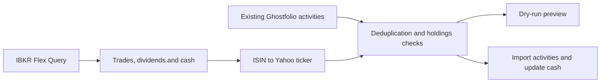

# ghostfolio-ibkr-sync

[](https://github.com/flowcool/ghostfolio-ibkr-sync/actions/workflows/docker-publish.yml)
[](https://github.com/flowcool/ghostfolio-ibkr-sync/actions/workflows/codeql.yml)
[](https://github.com/flowcool/ghostfolio-ibkr-sync/releases)

**Your IBKR trades, dividends and cash balance in self-hosted [Ghostfolio](https://ghostfol.io), on a daily schedule.**

| Import | Reconcile | Run |
| --- | --- | --- |
| Trades, dividend payments and withholding tax | Trade IDs, manual-entry matching and a holdings gate | Docker on amd64 / arm64, or plain Python |
| ISIN → Yahoo Finance ticker mapping | Separate Ghostfolio accounts for IBKR sub-accounts | One-off runs, cron scheduling and a preview with `DRY_RUN=1` |
| | Automatic Ghostfolio login from the security token | Optional failure alerts (ntfy, Telegram, email...) through Apprise |



[Get started](#get-started) · [Configuration](#configuration) · [Mapping](#mapping-file) · [Troubleshooting](#troubleshooting) · [Limitations](#limitations) · [Contribute](CONTRIBUTING.md)

## Get started

1. Configure [IBKR Flex Web Service and your query](#ibkr-setup), then [create your Ghostfolio account and token](#ghostfolio-setup). Use the same account currency as the IBKR base currency.
2. Copy [`mapping.yaml.example`](mapping.yaml.example) to `mapping.yaml` and review your securities' Yahoo tickers. The mapping file must exist unless you explicitly disable it.
3. Run the [Docker preview](#dry-run-first) with `DRY_RUN=1`. Review ticker mappings, skipped trades and the proposed cash balance before enabling writes.
4. After review, set `DRY_RUN=false` to permit writes. Run [once](#single-account-one-off-run), then configure [scheduled runs](#docker-compose--portainer). After the first import, gather historical market data in Ghostfolio.

**Before importing:** back up Ghostfolio using your deployment's backup procedure. The sync adds activities and updates cash; there is no automatic undo. The first Flex Query covers at most 365 days, so older positions must already be represented in Ghostfolio. Splits and other corporate actions need manual reconciliation. See [Limitations](#limitations).

## Overview

This tool fetches your IBKR activity statements via Flex Queries, parses trades and dividends, maps ISINs to Yahoo Finance tickers, and pushes everything into Ghostfolio. It handles multiple sub-accounts, deduplicates activities, updates cash balances, syncs dividend payments (including withholding tax), and skips FX conversions and options trades. With `GHOST_ACCESS_TOKEN` it logs in to Ghostfolio by itself at every run, so there is no session token to renew, and with `APPRISE_URLS` it sends one alert when a run fails or, in explicit live mode, the legacy session token is about to expire (see [Failure notifications](#failure-notifications-apprise)).

## Why this exists

This fork of [obol89/ghostfolio-ibkr-sync](https://github.com/obol89/ghostfolio-ibkr-sync) parses IBKR XML directly, uses only `requests` and `pyyaml` for the sync itself (Apprise is loaded only by a separate, optional notification worker), and keeps symbol mapping under your control. It is intended for investors operating their own Ghostfolio instance who want repeatable daily imports and visible reconciliation warnings.

## How it works

One run does this, in order:

1. Load the configuration and the symbol mapping. A missing or invalid mapping file stops the run before anything is contacted.
2. Read **all** existing Ghostfolio activities once. Deduplication depends on them, so if the list looks incomplete or redacted the run stops and writes nothing.
3. Then, for each IBKR account in turn (steps 3 to 6): fetch its Flex Query report (two steps: request, then poll until IBKR has generated the statement), find the Ghostfolio account by name (if `GHOST_ACCOUNT_NAMES` is unset, the IBKR account IDs are used as names, with a warning), and parse trades, dividend payments and the cash balance.
4. Decide what is new: skip FX and options; skip trades already in Ghostfolio (`IBKR#<tradeID>` comment) and trades without a trade ID (they cannot be deduplicated); skip dividends already in Ghostfolio (`dividend#...` comment, or a manual or legacy dividend, one without a `dividend#` comment, of the same symbol in the same account within ±3 days, logged as `INFO` when the gross agrees and as one `WARNING` otherwise); skip trades already entered by hand; and check the net quantity against existing holdings. This is a batch-level guard, not chronological position reconciliation.
5. Convert what is left to Ghostfolio activities and import them as a batch per account. If Ghostfolio reports an unresolved symbol, remove that symbol from the batch and retry the rest; the run still exits 1 so the omitted activities remain visible.
6. Set the account's cash balance. This happens even if the import failed; it is skipped, with a warning, only when the report has no base-currency cash row. The Ghostfolio account currency must equal the IBKR base currency (Account Information `CurrencyPrimary` in the Flex Query): on a mismatch, or when the report has no base currency, the update is refused with an `ERROR` naming the cause, no balance is sent and the account counts as failed. `DRY_RUN` still reads the account and reports the same refusal. After all accounts, the run exits `0` if every account was clean and `1` otherwise.

The tool never deletes or edits an existing Ghostfolio activity: it only adds new ones and updates each account's cash balance (and its platform, if `GHOST_PLATFORM_ID` is set and the account has none). Add `DRY_RUN=1` to see the whole decision without any write (see [Dry run first](#dry-run-first)).

Activities are read from `assetProfile` on current Ghostfolio APIs (the legacy
`SymbolProfile` response field was removed in 3.78.0). Legacy-only responses
remain supported for older versions. If both fields are present, `assetProfile`
takes precedence. BUY, SELL and DIVIDEND activities must have a profile with a
nonempty string `symbol`; otherwise the run stops before any import or cash
balance update. ISIN remains optional, as some assets do not have one.

## Docker image

```
ghcr.io/flowcool/ghostfolio-ibkr-sync:latest
```

Multi-arch image (linux/amd64 and linux/arm64). The next published stable
[GitHub Release](https://github.com/flowcool/ghostfolio-ibkr-sync/releases) starts
the stable channel: `vX.Y.Z` publishes `:X.Y.Z`, and only the current stable
release updates `:latest`. Existing `:X.Y` and staging aliases remain frozen;
they are not deleted. Main, tag pushes, manual runs and weekly checks publish
nothing. Weekly security checks remain; compatible security fixes require a new
PATCH release selected by the maintainer.

Before upgrading, record the installed image digest, rather than inspecting a
tag that may have moved. For a Compose service named `ibkr-sync`:

```bash
docker inspect --format '{{.Image}}' "$(docker compose ps -q ibkr-sync)"
docker image inspect --format '{{json .RepoDigests}}' <image-id-from-above>
```

For a container identified by name (any service name, for example the `container_name` of the
[Compose example](#docker-compose--portainer)), pass the name instead:

```bash
docker inspect --format '{{.Image}}' <container-name>
docker image inspect --format '{{json .RepoDigests}}' <image-id-from-above>
```

Save the matching `ghcr.io/flowcool/ghostfolio-ibkr-sync@sha256:...` reference
with the existing ENV and mounts. If no repository digest is recorded, stop and
identify the installed artifact before upgrading. Select a full version for
controlled upgrades or pin its digest for exact artifact selection. Container
tags remain mutable outside the workflow's overwrite guards.

A `vX.Y.Z-rc.N` release candidate may also exist. It is published as `:X.Y.Z-rc.N` and never
moves `:latest`, `:X.Y.Z` or `:X.Y`. A pinned `-rc.N` tag receives no automatic update: after the
stable release, change the image back to `:latest` (or pin `:X.Y.Z`). To test one on a scheduled
Compose install, see [Try a release candidate](docs/upgrading-to-3.0.md#try-a-release-candidate).

To roll back, select the saved digest and recreate the connector with the same
ENV and mounts. Older images can write with absent `DRY_RUN`; set
`DRY_RUN=true` explicitly for a rollback preview. This does not restore
financial records or undo cash updates.
Image publication does not deploy or recreate a container. A failed `latest`
promotion requires explicit operator recovery using the verified manifest digest
of the current stable release; never rebuild or overwrite its version tag. See
[release and recovery steps](docs/releasing.md) and
[build and release guarantees](.github/BUILD.md).

The running version is logged at container start and at the beginning of every sync:

```
ghostfolio-ibkr-sync version v2.2.0
2026-10-09 06:05:00 [INFO] Starting IBKR to Ghostfolio sync (version v2.2.0)
```

A release candidate reports its tag, for example `ghostfolio-ibkr-sync version v3.0.0-rc.2`.
New stable images, including `:latest`, report `vX.Y.Z`. Older main-built images
may report `vX.Y.Z-N-g<sha>` (N commits after the last release, exact commit `<sha>`).

### Upgrading to 3.0

3.0 contains breaking changes: the Flex query needs a time-zone suffix and more
dividend fields, and `TZ` must be set. Starting with rc.2, omitted or blank
`DRY_RUN` simulates; writes require an explicit false value. Read the
[3.0 upgrade and rollback guide](docs/upgrading-to-3.0.md) before pulling a new
image. A `v3.0.0-rc.N` release candidate may be published first for testing; it
never moves `:latest`. The guide also shows how to
[check that your Flex query is ready](docs/upgrading-to-3.0.md#is-my-flex-query-already-compliant)
and how to [try the candidate](docs/upgrading-to-3.0.md#try-a-release-candidate).

### Upgrading to 2.2

See the [2.2 upgrade and rollback guide](docs/upgrading-to-2.2.md).

## Prerequisites

- A running self-hosted Ghostfolio instance, version **2.248.0 or newer**
- An Interactive Brokers account with Flex Web Service enabled
- Docker (for containerised runs) or Python 3.14+ with the pinned packages from `requirements.txt` (CI and the container use Python 3.14)

The tool reads existing activities via `GET /api/v1/activities`, which landed in Ghostfolio 2.248.0. The `/api/v1/order` endpoints it replaced were deprecated in that same release and removed in 3.5.0, so on Ghostfolio 3.x this is the only endpoint that works.

## IBKR Setup

Follow the [Flex Web Service and query setup guide](docs/ibkr-setup.md):
enable the service, create one 365-day query per sub-account with the required
trade and cash fields, and obtain its Query ID.

Dividend quantities require
[the enriched Flex fields](docs/ibkr-setup.md#prepare-for-structured-dividend-quantities)
before upgrading. Cash Transactions still establish payments and withholding;
Change in Dividend Accruals supplies quantity evidence only. The connector no
longer infers quantity from descriptions or falls back to one unit. Missing,
conflicting or unsafe evidence rejects the affected payment with a warning.
A required Cash Transactions attribute, or the Change in Dividend Accruals
section, that is missing from the whole report fails the account before any
write (exit 1, one `ERROR` naming each field to tick). A single empty or
conflicting value rejects only the affected payment: trades and cash continue,
and that rejection does not change the exit code or send failure notifications.
Rejected payments retry on later runs; existing dividends are deduplicated first
and stay untouched and unverified.

Before upgrading, back up Ghostfolio and record the previous image digest. Keep
ENV and mounts available, and set a valid IANA `TZ` before enabling writes.
For runtime rollback, restore that digest and recreate the connector. Check the
previous runtime's timestamp format requirements before resuming writes.
Rollback does not undo financial writes. See the [upgrade procedure](docs/ibkr-setup.md#activate-timezone-aware-dividend-diagnostics)
and the [3.0 upgrade guide](docs/upgrading-to-3.0.md).

## Ghostfolio Setup

### 1. Choose how the sync authenticates

Set **exactly one** of these two variables (both set, or neither, stops the run with exit 1):

- **`GHOST_ACCESS_TOKEN` (recommended)** — the Ghostfolio *security token* you sign in with
  (shown when the user was created; Ghostfolio can generate a new one). At the start of every
  run, after the configuration and mapping file are validated and before anything is read from
  Ghostfolio or IBKR, the sync exchanges it once for a fresh session token via
  `POST /api/v1/auth/anonymous`. There is nothing to renew by hand. A dry run logs in too
  (logging in writes no financial data). The security token is long-lived: treat it like a
  password, and rotate it in Ghostfolio if it leaks.
- **`GHOST_TOKEN` (legacy)** — a session bearer you obtain yourself; it is used as is and
  **expires**, so you have to regenerate it periodically:

  ```bash
  curl -X POST http://localhost:3333/api/v1/auth/anonymous \
    -H 'Content-Type: application/json' \
    -d '{"accessToken": "YOUR_GHOSTFOLIO_SECURITY_TOKEN"}'
  ```

  The response contains an `authToken` field. Use it as `GHOST_TOKEN`.

With `GHOST_ACCESS_TOKEN`, `GHOST_HOST` must be a plain `http://` or `https://` URL (an
optional path is allowed): user credentials, a query string, a fragment, whitespace or control
characters are refused before any request. The login request does not follow redirects, so point
`GHOST_HOST` at the final Ghostfolio URL. A run never logs in again midway: if the session token
is refused later in the run, that run fails with exit 1 and the next run logs in afresh.

**Plain `http://` is for a trusted network only.** The login request carries the long-lived
security token in its body, so over `http://` anyone who can observe the path can capture it
(the session token of every later request, in either mode, is exposed the same way). Use
`http://` only when the sync reaches Ghostfolio over a private link, such as the internal Docker
network of a shared compose stack (`http://ghostfolio:3333`). When the traffic crosses any other
network, point `GHOST_HOST` at an `https://` URL.

**Switching modes / rollback:** remove one variable and set the other, then recreate the
container. Images released before `GHOST_ACCESS_TOKEN` existed only understand `GHOST_TOKEN`:
when rolling back to one, set `GHOST_TOKEN` again first.

### 2. Create an IBKR Platform

1. Go to Ghostfolio **Admin** - **Platform**
2. Click **Add Platform**
3. Enter a name like `Interactive Brokers` and a URL like `https://www.interactivebrokers.com`
4. Save it

To find the Platform ID, query the API with a session token (the `authToken` returned by the curl command above):

```bash
curl http://localhost:3333/api/v1/platform \
  -H 'Authorization: Bearer YOUR_AUTH_TOKEN'
```

Look for the `id` field of the IBKR platform entry. Use this as `GHOST_PLATFORM_ID`.

### 3. Create accounts

Create one Ghostfolio account per IBKR sub-account:

1. Go to **Accounts** and click **Add Account**
2. Set the name to match what you will use in `GHOST_ACCOUNT_NAMES` (for example `IBKR Individual` or `IBKR Joint`)
3. Select the IBKR platform you created
4. Set the currency to match the sub-account base currency
5. Repeat for each sub-account

### 4. Add currencies

If your IBKR trades involve currencies that are not yet in Ghostfolio:

1. Go to **Admin** - **Market Data**
2. Search for and add any missing currency pairs (for example `USDEUR`, `USDGBP`, `USDCHF`)
3. Ghostfolio needs these to convert values to your base currency

### 5. After your first import

After the first sync, go to **Admin** - **Market Data** and click **Gather All Data**. This fetches historical prices from Yahoo Finance for all newly imported symbols. Without this step, portfolio values and performance charts will be incorrect. Run it again after adding symbols from a new import.

## Configuration

All configuration is done via environment variables:

| Variable | Required | Description | Example |
|---|---|---|---|
| `IBKR_TOKEN` | Yes | IBKR Flex Web Service token | `1234567890abcdef` |
| `IBKR_ACCOUNT_IDS` | Yes | Comma-separated IBKR account IDs | `U1234567` |
| `IBKR_QUERY_IDS` | Yes | Comma-separated Flex Query IDs (one per account) | `123456` |
| `GHOST_ACCESS_TOKEN` | One of these two | Ghostfolio security token, exchanged for a session token at the start of each run (recommended; see [Ghostfolio Setup](#1-choose-how-the-sync-authenticates)) | `a1b2c3...` |
| `GHOST_TOKEN` | One of these two | Ghostfolio session bearer token, used as is (legacy; expires) | `eyJhbGciOi...` |
| `GHOST_TOKEN_EXPIRY_WARNING_DAYS` | No | Legacy token reminder window, integer 0-365 days (default `14`; `0` disables). Invalid values warn and use `14`. Ignored with `GHOST_ACCESS_TOKEN` | `14` |
| `GHOST_HOST` | Yes | Ghostfolio base URL | `http://ghostfolio:3333` |
| `GHOST_PLATFORM_ID` | No | Platform ID for IBKR in Ghostfolio | `abc123-def456` |
| `GHOST_ACCOUNT_NAMES` | No | Comma-separated Ghostfolio account names (must match account count). Two accounts cannot share one name: the run stops at start-up (exit 1) before any network call. Without names, the IBKR account IDs are the targets and must also be distinct | `IBKR Individual` |
| `MAPPING_FILE` | No | Path to symbol mapping YAML (default: `mapping.yaml`). The run stops (exit 1) if the file is missing or invalid; set it to an empty value (`MAPPING_FILE=""`) to run without mappings on purpose | `/app/mapping.yaml` |
| `CRON` | No | Five numeric cron fields for recurring runs (Docker only); validated before startup | `0 6 * * *` |
| `TZ` | For writes | Valid IANA timezone for historical dividend dates and cron scheduling. Missing or invalid values force the whole run into `DRY_RUN`, with a WARNING. Explicit false `DRY_RUN` retains the configured forced-preview notification, even on success | `Europe/Warsaw` |
| `LOG_LEVEL` | No | Logging verbosity: `DEBUG`, `INFO`, `WARNING`, `ERROR` (default: `INFO`) | `DEBUG` |
| `APPRISE_URLS` | No | JSON list of [Apprise](https://github.com/caronc/apprise/wiki) URLs for failures, legacy token expiry reminders and TZ-forced previews (blank or `[]` = off); see [Failure notifications](#failure-notifications-apprise) | `["ntfys://ntfy.sh/my-topic"]` |
| `APPRISE_TIMEOUT` | No | Seconds allowed for one notification, integer 1-30 (default `10`) | `10` |
| `DRY_RUN` | No | Since rc.2, absent/blank or `1`/`true`/`yes`/`on` simulates; only `0`/`false`/`no`/`off` requests writes. Spaces and case are ignored. Other values exit 1 before HTTP; only configured Apprise Failure delivery may follow. Simulation keeps login, reads and preview, without activity, cash or platform writes | `1` |

## Mapping File

The mapping file maps ISINs to Yahoo Finance ticker symbols. This is necessary because IBKR identifies securities by ISIN while Ghostfolio uses Yahoo Finance tickers for price data.

### Format

Use a `symbol_mapping` key at the top level (a missing or empty key is treated as an empty mapping with a warning):

```yaml
symbol_mapping:
  IE00B52MJD48: EIMI.L        # iShares MSCI EM IMI - London
  DE0002635307: EXSA.DE       # iShares STOXX Europe 600 - Frankfurt
  IE00B4L5Y983: IWDA.AS       # iShares Core MSCI World - Amsterdam
  CH0110869143: CHSPI.SW      # iShares Core SPI - Swiss Exchange
```

### Which symbols need mapping

US-listed securities (VOO, QQQ, NVDA, AAPL, etc.) are recognised by Yahoo Finance using the IBKR symbol directly, so they do not need an explicit mapping.

European ETFs and stocks require mapping because Yahoo Finance uses exchange suffixes that differ from IBKR symbols:

| Exchange | Suffix | Example |
|---|---|---|
| London Stock Exchange | `.L` | `EIMI.L` |
| Frankfurt / Xetra | `.DE` | `EXSA.DE` |
| Amsterdam | `.AS` | `IWDA.AS` |
| SIX Swiss Exchange | `.SW` | `CHSPI.SW` |

### Finding Yahoo Finance tickers

1. Go to [finance.yahoo.com](https://finance.yahoo.com)
2. Search for the security by name or ISIN
3. Use the ticker shown on the Yahoo Finance page, including the exchange suffix

### Unmapped ISINs

When the script encounters an ISIN not in the mapping file, it falls back to the IBKR symbol and **attempts to import the activity**. If Ghostfolio cannot resolve that ticker, the tool drops its activities, imports the remaining activities if any remain, and exits 1. At the end of the run it logs one self-contained warning per ISIN:

```
[WARNING] Unmapped ISIN JP3637000005 (TRINITY INDUSTRIAL CORP) uses IBKR symbol '6382.T' as ticker (fallback) — verify in Ghostfolio or add to mapping symbol_mapping: 'JP3637000005: <yahoo ticker>'
```

If the fallback ticker is wrong for Yahoo Finance, add the ISIN to your mapping file with the correct ticker. Trades are reported only on the run that imports them; dividends on the fallback are reported on every run.

## What the tool skips automatically

- **FX conversion trades** - trades with assetCategory `CASH` are currency conversions, not investment positions
- **Options trades** - trades with assetCategory `OPT` are skipped (Ghostfolio does not support options)
- **Sells that would make a position negative** - the Flex Query only covers 365 days, so a sell of a position bought earlier arrives without its buy. For each security (per Ghostfolio account, by the ticker it will be imported under), the tool adds the quantity Ghostfolio already holds to the net quantity of IBKR trades not yet imported. If the result is zero or more, the candidates pass the first check. Buys and dividends are submitted first; sells are checked again using only newly created buys confirmed by the server response. If it would go negative, that security is refused by the initial check. If the second check fails, successful buys from the first phase remain and the sells are skipped.
- **Sells you already entered by hand** - an IBKR sell is treated as already recorded when Ghostfolio has a manual sell (no `IBKR#` comment) of the same quantity within ±2 days, under any symbol sharing the ISIN. Several IBKR fills of one day are also matched against a single manual entry by their sum. When a manual sell is nearby but the quantity does not match, the sell is not imported and a warning asks you to check by hand.
- **Buys you already entered by hand** - the same rule applies to buys (manual buy without `IBKR#` comment, same quantity, ±2 days, any symbol sharing the ISIN, fills matched by their sum). Unlike sells, a skipped buy is **always** reported as a `WARNING` naming the trade ID and the manual entry, because skipping it silently would hide a missing purchase. To silence the warning, put `IBKR#<tradeID>` in that manual entry's comment: the trade is then recognised by ID. If the match is a coincidence (a different purchase with the same quantity within 2 days), or a nearby manual buy has another quantity, the IBKR buy stays skipped (and warned about on every run) until you add it by hand or fix the manual entry. This is deliberate: a visible gap is safer than a silent duplicate.
- **Positions held under another symbol** - if Ghostfolio holds the security under a different symbol with the same ISIN (for example a manual entry on another listing), the sell is not imported and a warning gives the mapping line that fixes it.
- **Dividend reversals and orphan tax corrections** - dividend and withholding rows of the same security and day are summed; a net zero (reversed payment) is skipped, and a withholding tax row without a dividend that day is not imported and logged as a `WARNING` to check by hand.
- **Duplicate activities** - the tool checks existing Ghostfolio activities before importing and skips anything already present.

### Log levels

Lab acceptance needs `LOG_LEVEL=DEBUG` for native `LAB_EVIDENCE` window, preview and cash records.

A clean, fully reconciled run normally emits only `INFO` lines. `WARNING` means *check this*, `ERROR` means *data is not in sync and needs action*:

| Level | Meaning |
|---|---|
| `DEBUG` | FX/options skipped, each sell not imported because already reconciled |
| `INFO` | Sells imported for long-held positions; one summary line of sells not imported (already entered manually, or no Ghostfolio position) |
| `WARNING` | Unmapped ISIN on symbol fallback; position held under another symbol; manual sell or buy nearby with another quantity; buy skipped because it matches a manual buy; withholding tax without a dividend the same day; network retry |
| `ERROR` | Ghostfolio holds some quantity but the IBKR sells exceed it — fix the position in Ghostfolio; IBKR/Ghostfolio request failures; account failed before any write because a Flex prerequisite is missing (time-zone suffix, dividend fields); cash balance refused (currency mismatch or no base currency); trade rejected (unknown `buySell`); run aborted before any write (see [Run stops before importing anything](docs/troubleshooting.md#run-stops-before-importing-anything)) |

## How activities are converted

| Source (IBKR) | Ghostfolio activity |
|---|---|
| Trade | `BUY` when IBKR says `BUY`, `SELL` when IBKR says `SELL`. Any other value (for example a cancellation) rejects the row: an error is logged, the account run is not ok and the other trades import normally. The row is never imported, so every run fails while it stays inside the 365-day report window. Quantity and price are absolute values. The comment is `IBKR#<tradeID>`, the data source is always `YAHOO`. |
| Commission | `fee` = the commission cost. A positive `ibCommission` (a rebate) is recorded as a fee of 0 and logged as a `WARNING`, because Ghostfolio fees cannot be negative. |
| Dividend | One `DIVIDEND` per security and day: dividends and payments in lieu are summed (a reversal nets out), withholding tax becomes the `fee`. A net refund of tax is recorded as a fee of 0 with a `WARNING`. The comment is `dividend#<ISIN>#<date>` (or the IBKR symbol when there is no ISIN) and the date is the date of the cash transaction at 00:00 UTC. A dividend is treated as already present if Ghostfolio has that comment, **or a manual or legacy dividend (one without a `dividend#` comment) of the same symbol in the same account within ±3 days**. Rows with a `dividend#` comment are the connector's own and are matched by exact comment only, so a distinct payment next to an imported one is imported. A payment skipped next to a manual or legacy row is never imported: the log shows `INFO` "amounts agree" when the gross matches, otherwise one `WARNING` with both dates, gross values and fees. Check IBKR and add the payment by hand if it is distinct. The exit status does not change. |
| Dividend quantity and price | Each net-positive cash action matches accruals by nonempty `accountId`, `conid`, `currency`, `actionID` and `exDate`. It needs exactly one `Re` with `payDate` on the cash day and `date` or `reportDate` on that day. All associated quantities must agree as positive finite decimals. Dividend/PIL portions and ordinary/bonus actions share one common quantity; quantities are never summed or rounded. Price = cash gross ÷ quantity, regardless of accrual gross, tax or rate. Zero-net actions provide no quantity; negative-net actions, mixed currencies and conflicting evidence reject the group. Quantity and price must remain positive finite numbers, and fees nonnegative finite, after conversion and minor-unit scaling; overflow or positive underflow rejects the group. |
| Date and time | IBKR timestamps are treated as UTC. A manual entry made in local time can differ by a day, which is why the manual-entry matching accepts ±2 days. |
| Currency | The trade or dividend currency, except on markets where Yahoo quotes the minor unit (below). |

**Minor-unit markets.** Yahoo Finance quotes some exchanges in the minor unit (pence, cents) while IBKR reports the major unit. For these the price **and** the fee (or withholding tax) are multiplied by 100 and the currency is changed so that amounts stay correct:

| Yahoo suffix | IBKR currency | Sent to Ghostfolio as | Status |
|---|---|---|---|
| `.L` (London) | GBP | GBp | verified on real trades |
| `.JO` (Johannesburg) | ZAR | ZAc | inferred, not verified |
| `.TA` (Tel Aviv) | ILS | ILA | inferred, not verified |

If you trade on `.JO` or `.TA` and amounts look 100 times off, check this table first.

## Running

### Single account (one-off run)

```bash
docker run --rm --network your-ghostfolio-network \
  -e DRY_RUN=true \
  -e TZ=Europe/Warsaw \
  -e IBKR_TOKEN=your_token \
  -e IBKR_ACCOUNT_IDS=U1234567 \
  -e IBKR_QUERY_IDS=123456 \
  -e GHOST_ACCESS_TOKEN=your_ghost_security_token \
  -e GHOST_HOST=http://ghostfolio:3333 \
  -e GHOST_ACCOUNT_NAMES="IBKR Main" \
  -v "$(pwd)/mapping.yaml:/app/mapping.yaml:ro" \
  ghcr.io/flowcool/ghostfolio-ibkr-sync:latest
```

### Without Docker

Docker is the only supported way to run the sync. The image installs the
`ghostfolio_ibkr_sync` package and starts it with `python -m ghostfolio_ibkr_sync`.
Since v3.0.0 there is no `ibkr_to_ghostfolio.py` file or launcher: running the
repository from a source checkout is not supported. To test local changes, build the
image yourself and run it as shown above:

```bash
docker build -t ibkr-sync:local .
```

### Dry run first

Starting with v3.0.0-rc.2, absent, empty or whitespace-only `DRY_RUN` selects
simulation. Every such invocation logs WARNING
`DRY_RUN not set: simulation, nothing written`, even if configuration fails.
Explicit `1`, `true`, `yes` or `on` also selects simulation. Values are trimmed
and case-insensitive. Only `0`, `false`, `no` or `off` requests live writes; all
other values exit 1 before any HTTP call. After rejection, only configured
Apprise Failure delivery may occur. No IBKR/Ghostfolio HTTP call or financial
write occurs. Other safety guards still apply.

Set `DRY_RUN=1` explicitly for the preview. The full pipeline runs (fetch, convert, deduplicate, gate) and the activities and cash balance that *would* be written are logged, but no activities are imported and no cash balance is updated. With `GHOST_ACCESS_TOKEN`, the authentication POST still exchanges the security token for a session token. IBKR report generation is requested and existing Ghostfolio data is read. This preview does not validate symbols through the Ghostfolio import endpoint, so a successful preview does not guarantee a successful import. Logs include financial activity details; keep them private.

Set a valid IANA `TZ`, such as `Europe/Warsaw`, even for one-off Python runs.
Missing or invalid `TZ` forces every account into `DRY_RUN` before processing,
with one WARNING explaining the reason. No activities, cash or platform are
written. With explicit false `DRY_RUN`, the final notification includes the
reason when Apprise is configured, even if all accounts succeed. Successful
simulations selected by default, blank or truthy `DRY_RUN` send no notification,
including expiry-only reminders and previews. Failed simulations send one
configured Failure notification. After review, set `DRY_RUN=false` and retain
valid `TZ` to permit writes.

Every DETAIL dividend, payment-in-lieu and withholding cash row must have
`dateTime` in `YYYYMMDD;HHmmss TimeZone` form, for example
`20260115;120000 EST` or `20260715;120000 EDT`. A missing or invalid suffix
fails the affected account before any import, cash or platform write. It does
not enable `DRY_RUN`; other accounts retain their configured mode. Other cash
types are outside this check. Follow the [staged activation and rollback
procedure](docs/ibkr-setup.md#activate-timezone-aware-dividend-diagnostics).

Every dry run also compares historical dividends in the target account before
deduplication. The INFO summary reports coverage and categories; details for
differences or uncertainty include source comments and activity IDs. A coherent
single activity has the canonical source comment, consistent security and local
date in `TZ`, and exactly equal quantity, gross and fee. The IBKR `YYYYMMDD`
is the source business day; the destination instant is rendered in `TZ` for
comparison. Flex suffixes provide provenance; import UTC conversion is unchanged.
Gross comes from broker cash; accruals establish quantity. Component quantities
are never summed. Several
activities with the same group comment do not prove a component partition,
even when their amounts sum correctly; that comparison stays uncertain.
An independently identified component set must cover every source component
exactly once. Each component keeps its own quantity and monetary comparison.
The reader does not invent component identities for historical activities.
Two or more identity-proven complete representations indicate probable repetition,
even if their quantities or amounts differ. Incomplete partitions and contested
ownership remain uncertain. Matching amounts never establish completeness, and
the diagnostic never searches arbitrary subsets of activities.

The diagnostic retains original JSON decimals from the existing activities GET.
It never reconstructs exact evidence from floats. Activity currency determines
the denomination; only an explicit null permits profile currency fallback, with
its provenance retained. Supported denominations are USD, EUR, GBP, CHF, JPY,
CAD, AUD, NZD, HKD, SGD, SEK, NOK, DKK, PLN, CZK, HUF, ILS, ZAR and the existing
GBp, ZAc and ILA minor units. Missing or unsupported context stays uncertain;
the log then shows the observed source and destination currency and provenance
on a `currency context:` line, whatever the supported list says.
Gross and fee differences use destination minus source, without a tolerance.
Every nonzero exact delta remains visible, including differences smaller than
float precision. Source fee is the positive part of the negative net cash
withholding; signed withholding and refund rows and their total remain separate
evidence. Coherence requires exact quantity, gross and fee agreement; a complete
representation with a discrepancy is not coherent.
The diagnostic adds no reads, writes or files. Findings do not change
import selection, cash updates, exit codes or notifications. Live runs do not
run this comparison. Use the one-off command below without `CRON`.

`absent` means no canonical destination comment was found. It does not establish
that a payment is missing: legacy comments, symbol-only comments, proximity and
timezone explanations cannot certify identity. Inactive or unsupported records,
conflicting security/date context and missing/conflicting accruals stay uncertain.
Missing destination profile ISIN is unavailable evidence and permits amount
comparison; a nonempty conflicting ISIN blocks identity. Details name the
active, activity-ID, data-source, symbol, local-date and ISIN checks with
expected and observed values. INFO counts failed checks and shows anomaly
blocks with securities, source and destination UTC/local dates, activity IDs,
quantity, gross, fee and currency. An `absent` group suppressed by deduplication
shows the skip path that import selection takes: `skipped by historical comment`
when the account has an old `dividend#<symbol>#<date>` comment (active or not),
else `skipped by proximity` (rows with a `dividend#` comment never count as proximity candidates, and the block also shows source and candidate gross). Each shows candidate values and active status; the
group remains absent and neither label certifies identity. Outside-window records also show their security,
date and values.
The summary counts source payment groups and unmatched destination dividends
separately. Every unmatched target-account dividend remains visible. A UTC date
outside explicit, consistent Flex statement `fromDate`/`toDate` bounds is reported
as `outside_window`; without valid bounds, history stays uncertain. The connector
does not infer a window from the first or last payment. Short reports cannot
verify older history. No category authorizes a repair.

Use a one-off container with no `CRON` environment variable. The command reads
only the report generated by its configured Flex query; Docker does not extend
the broker's report window. INFO includes anomaly and uncertainty details, IDs
and source references; DEBUG also includes coherent comparisons. Keep Docker
logs private and capture them before removing a container if you need evidence.
The diagnostic creates no persistent report and log retention depends on Docker's
logging configuration. Financial state remains unchanged, but authentication and
IBKR report generation still contact the configured services. Technical read
failures still fail the run; diagnostic findings do not send notifications.

```bash
docker run --rm --network your-ghostfolio-network -e DRY_RUN=1 -e LOG_LEVEL=DEBUG \
  -e TZ=Europe/Warsaw \
  -e IBKR_TOKEN=your_token -e IBKR_ACCOUNT_IDS=U1234567 -e IBKR_QUERY_IDS=123456 \
  -e GHOST_ACCESS_TOKEN=your_ghost_security_token -e GHOST_HOST=http://ghostfolio:3333 \
  -e GHOST_ACCOUNT_NAMES="IBKR Main" \
  -v "$(pwd)/mapping.yaml:/app/mapping.yaml:ro" \
  ghcr.io/flowcool/ghostfolio-ibkr-sync:latest
```

The dividend comparison ends with one line, `[DRY RUN] Dividend report: N to check, N informational, N noise`, followed by the detail of each item to check. Findings are written in plain English: the reason, the IBKR and Ghostfolio values side by side, one action line and the statement that nothing was written. Coherent and outside-window findings appear at `DEBUG` only. Differences of less than half a minor unit are noise; a difference of exactly one minor unit with equal quantity is named "minimal difference, cause unknown"; a legacy-comment row on the same security and day is named "probable duplicate". Each item to check that has a candidate carries a "Proposed match": the IBKR dividend and the candidate Ghostfolio rows, each labelled Keep, Duplicate or Differs, with a "strong" or "weak" confidence and the row to act on; with no candidate it reads "no confident match". A proposal never writes, repairs or changes the counts, exit code or notifications.

Look for lines starting with `[DRY RUN]`; when there is nothing to import the log simply says `No new activities to import`. Replace `your-ghostfolio-network` with the Docker network shared with Ghostfolio. Run it again after upgrading to a new version: comparing the log with the previous version's shows exactly what the new version changes.

## Flex retry policy

IBKR sometimes answers the Flex SendRequest step with a transient error. The
connector retries it by `ErrorCode`, never by message text.

- **Retried:** `1001`, `1004`, `1005`, `1006`, `1007`, `1008`, `1009`, `1018`,
  `1019`, `1021`.
- **Fail at once:** `1003`, `1010` to `1017` (including expired or invalid token
  `1012`/`1015`), `1020`, and any missing or unknown code.
- **Schedule:** at most five SendRequest attempts, with waits of 60, 120, 300 and
  600 seconds between them: 18 minutes of scheduled waiting. Network timeouts and
  connection retries come on top of that.
- **Exhaustion:** the run fails with the last IBKR message (token redacted), the
  statement is never requested, and nothing is written for the affected account.
  Other accounts in a multi-account run are still processed.
- **GetStatement window:** after SendRequest succeeds, the connector polls up to 60
  times, waiting 5 seconds after each pending response: 300 seconds of scheduled
  waiting (previously 10 attempts). Pending means status `Warn` or `ErrorCode`
  `1019`; any other error fails at once.
- **Polling exhaustion:** if all 60 responses stay pending, the run fails with a
  timeout and nothing is written for the affected account. Other accounts in a
  multi-account run are still processed.

No ENV change is needed. This is connector policy based on IBKR's
[Version 3 error table](https://www.ibkrguides.com/clientportal/performanceandstatements/flex3error.htm),
not a guarantee that IBKR recovers.

## Failure notifications (Apprise)

Optional. When `APPRISE_URLS` is set, a run that **completes with exit 1** sends one
notification through [Apprise](https://github.com/caronc/apprise/wiki), which supports
ntfy, Gotify, Telegram, Discord, Slack, email and many more. A completed successful run
in explicit live mode also sends a reminder when its legacy `GHOST_TOKEN` is about to expire (see
[Token expiry](docs/troubleshooting.md#token-expiry)); the reminder keeps exit 0. Give it a JSON list (up to 10
URLs, each up to 2048 characters; put one URL per entry, as an entry holding several
space- or comma-separated URLs counts each one toward the limit of 10):

```yaml
      APPRISE_URLS: '["ntfys://ntfy.sh/my-private-topic", "tgram://BOT_TOKEN/CHAT_ID"]'
      APPRISE_TIMEOUT: "10"
```

**What is sent:** a fixed title, the UTC time, how many accounts failed out of how many, and
one line per failure with a fixed stage and reason code (for example
`account: account_failed (account #2)`, where `#2` is the position in `IBKR_ACCOUNT_IDS`).
Never error messages, account IDs or names, symbols, amounts, URLs or tokens: read the
container log for details. Up to 20 failure lines, then `and N more`.
`ghost_startup: token_rejected` means Ghostfolio refused the token (HTTP 401/403): with the
legacy `GHOST_TOKEN` this is how an expired session token shows up (see
[Token expiry](docs/troubleshooting.md#token-expiry)).

Expiry reminders use the fixed code `ghost_auth: token_expiring` and a rounded-up count
of days remaining (`0` means expired). If the run also fails, the reminder is included
in the same failure notification. At most one notification is sent per completed run;
there is no daily state, so multiple runs in one day can repeat the reminder.

With explicit false `DRY_RUN`, missing or invalid IANA `TZ` also sends a final
notification naming the forced-preview reason, even on success. It shares the single summary with any
failures or expiry reminder. Notification delivery does not change exit status.

**Simulation since rc.2:** failed runs send one configured Failure notification,
including default, blank or truthy `DRY_RUN` and invalid-value rejection. Failure
with an expiry reminder or forced preview uses the same summary, never a second
dispatch. Delivery does not change exit status.

**When nothing is sent:** successful default/blank/truthy simulations, including
expiry-only reminders and previews; successful live runs without an expiry
reminder or forced preview; runs with only other warnings (for example unmapped
ISINs); runs stopped by a signal; and when `APPRISE_URLS` is blank or `[]`. If
`APPRISE_URLS` or `APPRISE_TIMEOUT` is invalid, the run logs
`APPRISE_URLS or APPRISE_TIMEOUT is invalid: failure notifications disabled` and syncs as usual.

**Delivery:** Apprise runs in a separate short-lived worker process with only network
settings in its environment (`PATH`, locale, CA bundle and proxy variables; never the IBKR or
Ghostfolio credentials), the URLs passed on its standard input, and its output discarded, so a
misbehaving plugin cannot print your destination credentials into the log. One deadline,
`APPRISE_TIMEOUT`, covers the whole worker (Python start, Apprise import, sending, exit); a
worker still running at the deadline is killed. This adds at most `APPRISE_TIMEOUT` seconds,
plus Apprise's import time inside it, to a notifying run. There is **no retry**: after a timeout
the notification may or may not have arrived (`Failure notification timed out (it may still
arrive; not retried)`). Delivery problems (`timeout`, `failed`, `invalid_destination`,
`unavailable` when Apprise cannot be imported, `payload_too_large`, `spawn_failed` when the worker
process (`python -I -m ghostfolio_ibkr_sync --notify-worker`) cannot start) are logged as warnings
and never change the run's exit code. Apprise and its pinned dependencies ship in the image
and are only imported by the worker.

**Rollback:** remove `APPRISE_URLS` (or set it to `[]`) and recreate the container; the sync
behaves exactly as without the feature. Older images ignore the variable.

## Docker Compose / Portainer

For scheduled runs with multiple sub-accounts, run a separate container per account with staggered cron times. The `CRON` environment variable uses [supercronic](https://github.com/aptible/supercronic) internally.

The image runs as the stable non-root UID/GID `10001:10001`. Before starting
the container, make the host mapping file readable by that owner:

```bash
chmod 0600 mapping.yaml
sudo chown 10001:10001 mapping.yaml
```

This works with the hardened profile's `cap_drop: [ALL]` and a read-only bind
mount. `chmod o+r mapping.yaml` is an alternative only when no matching named user
or group ACL entry denies read access. On POSIX ACL volumes, the ACL mask does
not apply to `ACL_OTHER`; matching entries with no effective read permission
deny access without falling through to `ACL_OTHER`. Check `getfacl mapping.yaml`.
Running as UID 0 does not bypass those permissions after all capabilities are
dropped. Use the same ownership for one-off Docker runs that bind-mount the file.

Use exactly five fields separated by a single space or tab, containing only
digits and `*`, `/`, `,`, `-` (for example `0 6 * * *` or `*/15 * * * *`).
Named days/months, macros such as `@daily`, seconds fields and embedded commands
are rejected. The entrypoint checks the grammar, then runs `supercronic -test`
before starting the scheduler. Invalid schedules exit 1 with a fixed diagnostic;
the supplied value and validator output are not logged. An unset or empty `CRON`
still runs the sync once immediately.

```yaml
services:
  ibkr-sync-individual:
    image: ghcr.io/flowcool/ghostfolio-ibkr-sync:latest
    user: "10001:10001"
    restart: unless-stopped
    read_only: true
    cap_drop: [ALL]
    security_opt: ["no-new-privileges:true"]
    tmpfs:
      - /tmp:rw,noexec,nosuid,size=16m,mode=1777
    environment:
      TZ: Europe/Warsaw
      DRY_RUN: "true"
      IBKR_TOKEN: ${IBKR_TOKEN:?Set IBKR_TOKEN}
      IBKR_ACCOUNT_IDS: U1234567
      IBKR_QUERY_IDS: 123456
      GHOST_ACCESS_TOKEN: ${GHOST_ACCESS_TOKEN:?Set GHOST_ACCESS_TOKEN}
      GHOST_HOST: http://ghostfolio:3333
      GHOST_ACCOUNT_NAMES: "IBKR Individual"
      MAPPING_FILE: /app/mapping.yaml
      CRON: "0 6 * * *"
      # Optional: Failure in any mode; expiry/TZ summaries in explicit live mode.
      # APPRISE_URLS: '["ntfys://ntfy.sh/my-private-topic"]'
    volumes:
      - ./mapping.yaml:/app/mapping.yaml:ro
    networks:
      - ghostfolio

  ibkr-sync-joint:
    image: ghcr.io/flowcool/ghostfolio-ibkr-sync:latest
    user: "10001:10001"
    container_name: ghostfolio-ibkr-sync-joint
    restart: unless-stopped
    read_only: true
    cap_drop: [ALL]
    security_opt: ["no-new-privileges:true"]
    tmpfs:
      - /tmp:rw,noexec,nosuid,size=16m,mode=1777
    environment:
      TZ: Europe/Warsaw
      DRY_RUN: "true"
      IBKR_TOKEN: ${IBKR_TOKEN:?Set IBKR_TOKEN}
      IBKR_ACCOUNT_IDS: U7654321
      IBKR_QUERY_IDS: 654321
      GHOST_ACCESS_TOKEN: ${GHOST_ACCESS_TOKEN:?Set GHOST_ACCESS_TOKEN}
      GHOST_HOST: http://ghostfolio:3333
      GHOST_ACCOUNT_NAMES: "IBKR Joint"
      MAPPING_FILE: /app/mapping.yaml
      CRON: "5 6 * * *"
    volumes:
      - ./mapping.yaml:/app/mapping.yaml:ro
    networks:
      - ghostfolio

networks:
  ghostfolio:
    external: true
```

Both services select simulation explicitly. Review each preview, then change
`DRY_RUN` to `"false"` in each service and recreate the containers to permit
writes. Keep valid `TZ`; other safety guards still apply.

Use `http://ghostfolio:3333` (internal Docker network hostname) rather than an external IP or localhost. Stagger the cron times by a few minutes so the two containers do not run simultaneously.

Supply `IBKR_TOKEN` and `GHOST_ACCESS_TOKEN` through the environment used by
Compose, a private `.env` file beside the Compose file, or Portainer stack
environment variables. Do not put real credentials into the YAML. For a local
`.env`, restrict permissions to its owner (`chmod 600 .env`) and keep it out of
version control and shared backups/artifacts. Required-value interpolation
refuses startup configuration when either credential is missing or empty.
`docker compose config` can print resolved secrets: prefer `config --quiet`
for validation and never share resolved output. Environment values are not a
secret vault; administrators with Docker access can inspect them.
Both services share these variables when their credentials are the same. If
they differ, use separate required variables per service, for example
`IBKR_TOKEN: ${IBKR_TOKEN_JOINT:?Set IBKR_TOKEN_JOINT}` and
`GHOST_ACCESS_TOKEN: ${GHOST_ACCESS_TOKEN_JOINT:?Set GHOST_ACCESS_TOKEN_JOINT}`
for the joint account, and supply those values through the same private sources.

This example uses the recommended access-token mode. For legacy session-token
mode, replace the `GHOST_ACCESS_TOKEN` line in **both** services with
`GHOST_TOKEN: ${GHOST_TOKEN:?Set GHOST_TOKEN}` and do not set both modes.

The read-only root keeps application code immutable. The private runtime
crontab is generated under `/tmp`; its 16 MiB tmpfs is writable, non-executable
and ephemeral. The sync itself does not write persistent files. Optional
notification plugins may have their own storage requirements; verify your
configured notifier before adopting a read-only root filesystem.
Use a **published** image containing the `/tmp` crontab change: older images
writing `/app/crontab` cannot run this hardened example. Merging the runtime
change is not enough: wait for its image publication workflow to succeed, then
pull and recreate the container. `:latest` remains the example's choice and
follows the current stable release after the next-stable cutover; operators may
instead select an available full version or a recorded digest for controlled
upgrades. No deployment is changed automatically.

This is a standalone sync stack for an existing Ghostfolio instance. Replace the credentials, account names and network name before deploying. In Portainer, use an absolute host path for `mapping.yaml` and give it owner `10001:10001` with mode `0600` as described above. The mount is read-only. A scheduled container waits for its first cron tick; remove `CRON` for an immediate one-off run. A separate stack does not wait for Ghostfolio readiness.

### Run once by hand in a scheduled container

To trigger one run without waiting for the cron tick, execute the cron command in the running
container. It uses the container's environment, so `DRY_RUN` behaves as configured (with `DRY_RUN`
true, nothing is written):

```bash
docker exec <container> python -m ghostfolio_ibkr_sync
```

This is the only supported way to run the sync by hand. The old
`python /app/ibkr_to_ghostfolio.py` command no longer works: v3.0.0 removed that file
without a compatibility launcher, so update any script or note that calls it.

## Troubleshooting

See the [troubleshooting guide](docs/troubleshooting.md) for exit codes,
import failures, missing positions, token expiry and login diagnostics.
For interrupted operator maintenance, use the [cleanup recovery guide](docs/cleanup.md).

## Limitations

- **Flex XML size** - each SendRequest or GetStatement response is limited to
  10 MiB (10,485,760 response-body bytes) before XML parsing. Larger responses
  fail with `IBKR Flex response exceeds XML size limit`; no financial writes
  are made for that query. The limit includes the exact boundary and measures
  the body after HTTP decompression, not a Content-Length header. This is a
  parsing guard, not a streaming download or total-memory limit: `requests`
  still buffers the response before the check. Keep the 365-day recovery
  window; review unnecessary Flex fields/sections rather than shortening it
  just to fit the limit.
- **No options support** - Ghostfolio does not support options as an asset class; options trades are skipped entirely
- **365-day window** - IBKR Flex Query maximum period is 365 days. On the first run, trades older than that are not imported: enter older buys by hand (or keep them from a previous tool). Afterwards the daily sync accumulates history in Ghostfolio, and later sells of those positions are imported as long as Ghostfolio holds the buy.
- **Yahoo Finance data quality** - price data can have gaps, delays, or missing metadata (sector, country) for non-US ETFs and smaller listings
- **Stock splits and other corporate actions are not handled** - Ghostfolio keeps your transactions as they were, while Yahoo returns split-adjusted prices, so a split makes the valuation wrong until the old transactions are corrected by hand (multiply the quantity and divide the unit price by the ratio, and fix the stored market data). The Corporate Actions section of Flex reports is not parsed; it does not create split or merger activities.
- **Cash balance is a single base-currency figure** - the balance written to each Ghostfolio account is IBKR's total ending cash in the account's base currency, with no conversion. The Ghostfolio account must have the same currency as the IBKR base currency (see [Create accounts](#3-create-accounts)); the sync refuses to write the balance otherwise.
- **Daily data only** - Activity Statements update once daily after market close; intraday syncing is not possible
- **Token management** - the IBKR Flex token expires and requires manual renewal: set a recurring calendar reminder (up to 1 year). On the Ghostfolio side, `GHOST_ACCESS_TOKEN` logs in on every run; only the legacy `GHOST_TOKEN` needs manual renewal.
- **Account-scoped queries** - use a separate Flex Query per sub-account. Several account/query pairs can run sequentially in one container; separate containers are recommended for operational isolation.
- **Additive imports** - later IBKR corrections to already-imported trades or same-date dividends are not reconciled. Dividend proximity matching (manual or legacy rows only, never rows with a `dividend#` comment) can suppress a distinct payment within ±3 days; the skip is logged (`INFO` when the gross agrees, one `WARNING` otherwise) and the payment must then be added by hand. A row with a `dividend#` comment is trusted by exact identity; editing such a row is outside the contract. Check unusual payment schedules and tax corrections manually.
- **Commission currency** - commissions are booked in the activity currency; a different IBKR commission currency is not converted.
- **Cleanup is not transactional** - cleanup requires complete financial evidence, equal fees, a unique one-to-one pair and unchanged fresh copies of both rows. Draft or excluded candidates are refused. PUT can succeed while DELETE fails; stop and inspect both rows and the safety log before any recovery. A new apply writes a private YAML journal with exact preimages and known/unknown outcomes. Explicit journal recovery can finish an unchanged pair; it does not recreate deleted activities or repair changed records.
- **Active position context** - drafts and excluded activities/accounts retain their import identifiers for deduplication, but cannot contribute holdings, manual matches or dividend proximity evidence. Holdings and manual reconciliation use active YAHOO profiles; other sources cannot back YAHOO sells. Excluded target accounts are refused. Future timestamps are deferred with exit 1 until a later run; this conservative instant check avoids server-local draft assignment even when import responses omit tags. Accepted imports use the actual server profile symbol; a canonicalized symbol can require an explicit mapping before sells under the original ticker are allowed.
- **Batch guard limitations** - the gate checks net quantity, not chronological balances. Buy and sell phases are separate requests, so successful buys can remain if sells fail. A dry-run previews candidates without verifying server acceptance.
- **No overlap protection** - avoid concurrent sync runs targeting the same Ghostfolio account; deduplication is based on a snapshot read at startup.

## Inspecting an interrupted cleanup

The [cleanup and recovery guide](docs/cleanup.md) explains separately authorized
maintenance, private journals, read-only inspection and guarded resume.
Cleanup is not part of the additive sync; review its safety requirements first.

## Development

See the [architecture decision records](docs/adr/README.md) for the existing
sync boundaries, financial trade-offs and reviewed DEGIRO core propagation.

The sync is the Python package `ghostfolio_ibkr_sync` (one module per concern, strictly typed application code), installed in the image and started with `python -m ghostfolio_ibkr_sync`; Docker is the only supported way to run it. It has `requests` and `pyyaml` as its only runtime dependencies; `apprise` (with a pinned dependency closure in `requirements.txt`) is imported only by the notification worker (`--notify-worker`). Tests are offline (no network, no Ghostfolio, no IBKR): they exercise the pure decision logic with mocked HTTP. `scripts/check.sh` runs Ruff, strict mypy and pytest.

```bash
python3 -m venv .venv
.venv/bin/pip install -r requirements-dev.txt   # pytest stays out of the Docker image
.venv/bin/python -m pytest -q   # or scripts/check.sh: Ruff, mypy, pytest
```

CI runs tests, an audit of the complete Python CI environment and Docker builds/scans for amd64 and arm64 on every pull request to `main`, including documentation-only changes. Required checks must pass before merging; PR builds never publish images. CodeQL analyzes Python separately. See [.github/BUILD.md](.github/BUILD.md) for publication rules, weekly maintenance and rollback. A change to the sync logic should come with a test; use synthetic fixtures and mocked HTTP for regression checks. See [Contributing](CONTRIBUTING.md) for review and reporting guidance.

Every runtime dependency is pinned. Renovate proposes ordinary Python, GitHub Actions and image updates; Dependabot handles security update PRs. The daily [dependency release watch](.github/workflows/dependency-release-watch.yml) opens one `dependency-release` issue per new stable Supercronic release. Adoption requires updating the version and both architecture checksums together in a reviewed PR. Python packages do not produce release notices. The separate [Ghostfolio release watch](.github/workflows/upstream-release-watch.yml) opens compatibility notices. Both watches deduplicate against open and closed issues. See the [upstream inventory](docs/upstreams.md) for pins and monitoring paths.

## Credits and license

Forked from [obol89/ghostfolio-ibkr-sync](https://github.com/obol89/ghostfolio-ibkr-sync), with thanks to its contributors. See [LICENSE](LICENSE) for the inherited **MIT NON-AI License**, including its additional restrictions.
